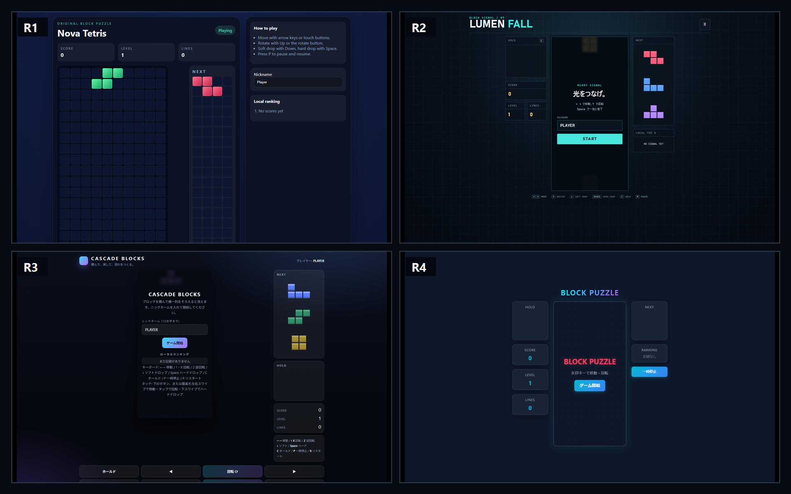

同じプロンプトから生成された4作品。画像内のR1〜R4はブラインド評価用IDです。

## はじめに

GitHub Copilotでは複数のAIモデルを選べます。しかし、モデル名やベンチマークスコアだけでは、実際のコーディングでどれを選ぶべきか判断しにくいと感じていました。

そこで、次の4モデルへ同じプロンプトを渡し、ブラウザーで遊べる落ちものブロックパズルを作らせました。

- GPT-5.6 Sol
- Claude Opus 5
- Gemini 3.6 Flash
- MAI-Code-1-Flash

比較したのは、所要時間、AI Credit、デザイン、機能、コード品質、セキュリティ、テスト、技術選定です。

> 注意: これは2026年8月4日時点、各モデル1回の実測です。モデル一般の優劣を断定するものではありません。モデル名、提供状態、料金体系は変更される可能性があります。

## TL;DR（先に結論）

- **最速**: MAI-Code-1-Flash、約4分1秒
- **最少AI Credit**: Claude Opus 5、58.9 Credits
- **デザイン1位**: GPT-5.6 Sol、27/30
- **暫定総合1位**: GPT-5.6 Sol、93/100
- 「完成」と報告されても、build失敗、テスト失敗、保存データによるクラッシュ、9,519pxの画面などが見つかった
- 公開リポジトリでCodeQLを実行し、重大なセキュリティアラート0件、未使用変数のNote 3件を検出

最速、最少Credit、総合1位は別々のモデルでした。単純に高性能モデルを選ぶだけでなく、用途と外部品質ゲートを組み合わせる必要があります。

## 1. 実験条件

### 1-1. 実行環境

| 項目 | 値 |
| --- | --- |
| OS | Windows 11 Pro |
| CPU | Intel Core i7-1265U |
| メモリ | 31.8 GB |
| VS Code | 1.131.0 |
| GitHub Copilot | 0.59.0、VS Code同梱版 |
| 実行方式 | GitHub Copilot Agent、対象モデルを明示 |

各モデルには空の独立フォルダーと新規コンテキストを割り当て、他モデルの成果物を参照させていません。実行順はPowerShellの`Get-Random`で無作為化しました。

| 実行順 | ブラインドID | モデル |
| ---: | --- | --- |
| 1 | R1 | MAI-Code-1-Flash |
| 2 | R2 | GPT-5.6 Sol |
| 3 | R3 | Claude Opus 5 |
| 4 | R4 | Gemini 3.6 Flash |

### 1-2. なぜ時間だけでなく作業量も制限したのか

最初にClaude Opus 5へ制限なしで依頼したところ、完了まで74分25秒かかりました。4,155行、89テストに加え、要件外のTスピン、Back-to-Back、コンボ、詳細な回転規則まで実装していました。

品質は高い一方、これでは速度比較ではなく「どこまで作り込んだか」の比較です。正式試行では次の上限を追加しました。

- 20分以内を目標
- ツール呼び出し12回以内
- 自作ファイル15個以内
- 自動テスト20件以内
- 最終検証1回、失敗時の修正・再検証は1回まで
- 要件外の高度なゲーム仕様は実装しない

同じClaude Opus 5でも正式試行は12分40秒、8ファイル、18テストに収まりました。時間制限だけでなく、成果物量と反復回数を固定することが効きました。

## 2. 全モデルへ送った課題

共通プロンプトでは、10×20盤面、7種類のピース、移動・回転・ドロップ、NEXT、HOLD、ゴースト、スコア、レベル、ランキング、キーボード／タッチ操作、レスポンシブUI、入力値と保存データの安全な処理、自動テスト、build／Lint／test成功を要求しました。

技術スタックは指定せず、モデル自身に選ばせています。モデルの技術選定能力も評価対象にするためです。

<details><summary>作業量制限の主要部分（クリックで展開）</summary>

```text
これは時間制限付きの実装です。開始後20分以内の完了を目標とし、次の作業量上限を守ってください。
- ツール呼び出しは合計12回以内
- 自分で作成するソース、テスト、設定、文書は合計15ファイル以内
- 自動テストは合計20ケース以内
- 依存関係のインストールは1回、最終検証は1回
- 最終検証で失敗した場合の修正と再検証は1回まで
```

</details>

## 3. 計測と評価方法

### 3-1. 時間とAI Credit

時間はプロンプト開始から最終成果物までの壁時計時間です。AI Creditは各試行の直前・直後にCopilot Usage APIの残量を取得し、次の差分で計算しました。

$$
\text{消費AI Credit}=\text{終了時の累計使用量}-\text{開始時の累計使用量}
$$

これはモデルAPI単体のトークン料金ではありません。Agentの推論やツール利用を含むGitHub Copilot上の実測値です。Usage反映遅延の影響もあり得ます。

### 3-2. デザイン

モデル名、時間、Credit、コードを伏せ、比較対象外のClaude Sonnet 5へ次の画像だけを渡しました。

- デスクトップ: システムEdge、1440×900
- モバイル: システムEdge、390×844
- localStorageを消去した初期状態

デザイン20点、視覚UX10点で採点しています。単一AIモデルによる主観評価なので、人による追加評価を行う場合は別表にします。

### 3-3. 品質

モデルの完了報告をそのまま信じず、次を独立実行しました。

- Production build
- Lintまたは構文チェック
- 自動テスト
- `npm audit`
- システムEdge＋Playwright Coreによる開始操作
- デスクトップ／モバイルのページ寸法
- XSS文字列の表示
- 改ざんしたlocalStorageの読み込み
- VS CodeのTypeScript／CSS／HTML診断

## 4. 結果

### 4-1. 速度・Credit・技術選定

| モデル | 時間 | AI Credit | 技術選定 | 自作行数 | テスト |
| --- | ---: | ---: | --- | ---: | ---: |
| MAI-Code-1-Flash | 約4分1秒 | 69.9 | JavaScript／DOM Grid | 671 | 8/8成功 |
| GPT-5.6 Sol | 約5分50秒 | 267.9 | JavaScript／Canvas | 817 | 12/12成功 |
| Claude Opus 5 | 約12分40秒 | 58.9 | TypeScript／Canvas、Vite | 1,281 | 18/18成功 |
| Gemini 3.6 Flash | 約6分18秒 | 126.6 | React＋TypeScript／Canvas | 1,074 | 9/10成功 |

今回の最少CreditはClaude Opus 5でした。ただし単一試行かつCopilot上の利用量であり、各モデルのAPI価格順を示すものではありません。

### 4-2. 客観品質ゲート

| ゲート | MAI | GPT | Opus | Gemini |
| --- | --- | --- | --- | --- |
| Production build | 未定義 | 成功 | 成功 | TypeScriptエラー |
| Lint | 未定義 | 構文チェック成功 | ESLint成功 | 未定義 |
| 自動テスト | 8/8 | 12/12 | 18/18 | 9/10 |
| 依存監査 | 依存0 | 依存0 | High 11 | Critical 1、High 1、Moderate 2 |
| XSS入力 | 不発 | 不発 | 不発 | 不発 |
| 破損保存データ | 要素検証不足 | 正常起動 | 正常起動 | 画面全体がクラッシュ |
| モバイルページ高 | 9,519px | 844px | 1,341px | 1,134px |

### 4-3. デザイン評価

| 順位 | ID／モデル | デザイン | 視覚UX | 合計 |
| ---: | --- | ---: | ---: | ---: |
| 1 | R2／GPT-5.6 Sol | 18/20 | 9/10 | 27/30 |
| 2 | R3／Claude Opus 5 | 15/20 | 6/10 | 21/30 |
| 3 | R1／MAI-Code-1-Flash | 13/20 | 4/10 | 17/30 |
| 4 | R4／Gemini 3.6 Flash | 10/20 | 5/10 | 15/30 |

GPTのLUMEN FALLは、世界観、情報設計、タッチ操作、ビューポートへの収まりが高く評価されました。

### 4-4. 暫定総合点

| 順位 | モデル | 総合点 |
| ---: | --- | ---: |
| 1 | GPT-5.6 Sol | **93/100** |
| 2 | Claude Opus 5 | **82/100** |
| 3 | MAI-Code-1-Flash | **59/100** |
| 4 | Gemini 3.6 Flash | **54/100** |

CodeQL実行後も同一原因の重複減点は行わず、総合点は変わりませんでした。GitHub Code Qualityは別ライセンスのため未実行です。

## 5. モデルごとに何が違ったか

### 5-1. MAI-Code-1-Flash: 最速だが、1行の設計ミスが画面全体へ波及

依存なしのJavaScriptを選び、約4分で8テストを通しました。しかし盤面、NEXT、HOLDへ同じ200セルを生成していました。NEXTとHOLDが4列×50行となり、モバイルのページ高は9,519pxです。

単体テストは全件成功していても、DOM構造と見た目の問題は検出できませんでした。E2E画像とページ寸法の確認が必要な例です。

### 5-2. GPT-5.6 Sol: Creditは最大だが、最も安定

外部依存なしのJavaScriptとCanvasを選び、build、構文チェック、12テスト、XSS、破損保存データ、デスクトップ／モバイル表示がすべて成功しました。

4作品で唯一、デスクトップ900px、モバイル844pxの初期ビューポートへ収まっています。今回の総合1位ですが、AI Creditは267.9で最大でした。

### 5-3. Claude Opus 5: 型とテストは強いが、依存監査に課題

TypeScript、Vite、Vitest、ESLintを選択し、build、Lint、18テストに成功しました。保存データの型・範囲検証も実装しています。

一方、`npm audit`では開発依存にHigh 11件が検出されました。ランタイム依存が0でも、開発サーバーや再現ビルド環境のリスクは別に評価する必要があります。

### 5-4. Gemini 3.6 Flash: Reactを選んだが、完了報告と実態に差

唯一Reactを採用しました。ReactのエスケープによりXSS文字列は実行されませんでした。

しかし、未使用変数によるTypeScript build失敗、スコア期待値の不一致によるテスト失敗、VitestのCritical、配列でない保存データによる画面クラッシュがありました。完了報告にはこれらの失敗が記載されていませんでした。

## 6. CodeQLなどGitHubのサービスをどう組み込むか

### 6-1. 全プランで使えるもの

GitHubの公式ドキュメントでは、Dependency graph、SBOM、Dependabot alerts、Dependabot version updatesなどは全プランで利用できます。今回のワークスペースには、npmとGitHub Actionsを週次確認する`dependabot.yml`を用意しました。

### 6-2. CodeQL

CodeQLはJavaScript／TypeScriptを正式サポートし、セキュリティ脆弱性と既知のコーディングエラーを検出できます。

- 公開リポジトリ: CodeQL code scanningを無料で利用可能
- 非公開／内部リポジトリ: GitHub Code Securityの利用権が必要
- GitHub Enterpriseプランへ所属しているだけでは、自動的にGitHub Code Securityが含まれるとは限らない

今回、公開リポジトリで`javascript-typescript`と`security-and-quality` query suiteを実行しました。ワークフローは成功し、Security重大度付きアラートは0件、未使用ローカル変数のNoteが3件でした。R4の1件は既知のbuild失敗と同一原因だったため、重複減点していません。

### 6-3. GitHub Code Quality

GitHub Code Qualityは、CodeQLルール、AI検出、カバレッジ、品質しきい値を使って保守性と信頼性を評価できます。GitHub Enterprise本体とは別の利用条件があり、AI検出やCopilot AutofixはAI Creditも消費します。

今回の個人アカウント所有リポジトリでは、setup APIが`404 Code quality is not available for this repository.`を返しました。公開リポジトリでも個人Free所有では利用できず、GitHub TeamまたはEnterprise Cloud配下のOrganizationとCode Qualityの利用権が必要です。

生成モデルのCredit比較へ混ぜないため、利用できる環境へ移管する場合も、4モデルの生成値を確定した後に外部評価コストとして分離して実行します。

### 6-4. 代替案

GitHub Code Qualityを利用できない場合は、SonarQube Cloudを4作品すべてへ同一Quality Profileで適用します。CodeQLだけでは、命名、責務分離、理解しやすさを単独で評価できないためです。

## 7. ハマったポイント

| ポイント | 学び |
| --- | --- |
| 制限なしOpusが74分 | 時間だけでなくファイル数、テスト数、反復回数を制限する |
| モデルの完了報告と実態が違う | build、test、auditを評価者側で再実行する |
| 単体テスト成功でも画面が9,519px | E2E画像と`scrollHeight`を計測する |
| VS Code統合ブラウザーと外部Edgeでクリック結果が異なる | 最終判定は実ブラウザーに近い独立環境で再現する |
| 撮影ビューポートが不正確 | `innerWidth`、`clientWidth`も証跡に残す |
| Code QualityもCreditを使う | 生成コストと評価コストを分離する |

## まとめ

今回の単一試行では、GPT-5.6 Solが速度、デザイン、品質のバランスで総合1位でした。MAIは最速、Claude Opus 5は最少Creditと静的品質、Gemini 3.6 FlashはReactによる構造化という特徴が出ています。

それ以上に重要だったのは、モデル自身の「完了しました」という報告だけでは品質を判断できなかったことです。AI生成コードでも、CI、依存監査、CodeQL、E2E、破損データテストを、人が書いたコードと同じ品質ゲートへ通す必要があります。

検証コードと証跡は[公開GitHubリポジトリ](https://github.com/ylearning86/ai-coding-model-benchmark)で確認できます。GitHub Code Qualityは現在の所有形態では利用できないため、追加評価を行う場合はTeam／GHEC Organizationへ移管するか、SonarQube Cloudを同一条件で実行します。

## 参考リンク

- [Supported AI models in GitHub Copilot](https://docs.github.com/copilot/reference/ai-models/supported-models)
- [Models and pricing](https://docs.github.com/copilot/reference/copilot-billing/models-and-pricing)
- [GitHub security features](https://docs.github.com/code-security/getting-started/github-security-features)
- [Code scanning with CodeQL](https://docs.github.com/code-security/code-scanning/introduction-to-code-scanning/about-code-scanning-with-codeql)
- [Configuring advanced setup for code scanning](https://docs.github.com/code-security/how-tos/find-and-fix-code-vulnerabilities/configure-code-scanning/configuring-advanced-setup-for-code-scanning)
- [GitHub Code Quality](https://docs.github.com/code-security/code-quality)
- [GitHub Code Quality billing](https://docs.github.com/en/billing/concepts/product-billing/github-code-quality)
- [Dependabot alerts](https://docs.github.com/code-security/dependabot/dependabot-alerts/about-dependabot-alerts)
- [SonarQube Cloud](https://docs.sonarsource.com/sonarqube-cloud/)

> 本記事は GitHub Copilot および Microsoft Foundry を活用して作成されています。内容の正確性については各公式ドキュメントをご確認ください。
